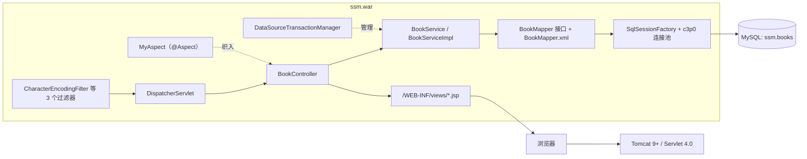

# SSM 书籍管理系统（ssm）

一个基于 **Spring + Spring MVC + MyBatis** 的书籍信息增删改查（CRUD）演示项目。项目采用传统的 XML 配置方式，不使用 Spring Boot，最终打包为 `WAR` 部署到外部 Servlet 容器。代码规模小、层次清晰，适合用于学习 SSM 整合、双容器配置、MyBatis Mapper 映射以及 JSP/JSTL 视图渲染。

> 项目性质：**教学 / 练习型单体 Web 应用**，未包含登录鉴权、接口层、前后端分离等生产化能力。

---

## 目录

- [1. 项目概览](#1-项目概览)
- [2. 技术栈与依赖](#2-技术栈与依赖)
- [3. 目录结构](#3-目录结构)
- [4. 架构与请求链路](#4-架构与请求链路)
- [5. 功能与 URL 路由](#5-功能与-url-路由)
- [6. 数据库设计](#6-数据库设计)
- [7. 配置文件详解](#7-配置文件详解)
- [8. 构建、部署与运行](#8-构建部署与运行)
- [9. 测试](#9-测试)
- [10. 已知问题与改进建议](#10-已知问题与改进建议)
- [11. Git 与忽略规则](#11-git-与忽略规则)
- [12. 常见问题（FAQ）](#12-常见问题faq)

---

## 1. 项目概览

| 项 | 值 |
| --- | --- |
| GroupId / ArtifactId | `com.wxf` / `ssm` |
| 版本 | `1.0-SNAPSHOT` |
| 打包方式 | `war`（`finalName=ssm`，即 `target/ssm.war`） |
| 源码 / 目标 JDK | `1.8`（`maven.compiler.source/target`） |
| 源码编码 | `UTF-8` |
| 包名 | `org.wxf.crud` |
| 业务域 | 单表 `books` 的查询、新增、修改、删除 |
| 视图技术 | JSP + JSTL + Bootstrap 4.6.1（CDN） |
| 默认访问入口 | `http://localhost:8080/ssm/`，首页跳转 `/book/allBook` |
| 仓库 | `https://github.com/wxingfu/ssm.git`（分支 `master`） |

项目实现的功能闭环：

1. 首页 `index.jsp` 提供「点击进入列表页」链接；
2. 列表页展示全部书籍，并提供「新增 / 更改 / 删除」入口；
3. 新增页、修改页通过表单提交，写入或更新数据库；
4. 所有写操作使用 `redirect:/book/allBook` 回到列表页（PRG 模式，避免刷新重复提交）。

---

## 2. 技术栈与依赖

### 2.1 分层技术栈

| 层次 | 技术 | 版本 | 项目中的落地位置 |
| --- | --- | --- | --- |
| 视图层 | JSP / JSTL / EL | JSTL 1.2 | `src/main/webapp/WEB-INF/views/*.jsp` |
| 前端样式 | Bootstrap | 4.6.1（CDN） | 三个 JSP 页面 `<link>` 引入 |
| Web 层 | Spring MVC | 5.2.6.RELEASE | `BookController`、`springmvc-servlet.xml` |
| 业务层 | Spring IoC / AOP / 声明式事务 | 5.2.6.RELEASE | `BookService` / `BookServiceImpl`、`applicationContext.xml` |
| 持久层 | MyBatis + mybatis-spring | 3.5.3 / 2.0.3 | `BookMapper.java`、`mapper/BookMapper.xml` |
| 连接池 | c3p0 | 0.9.5.2 | `applicationContext.xml` 的 `poolDataSource` |
| 数据库 | MySQL + Connector/J | 8.x / 8.0.20 | `db.properties`、`ssm.sql` |
| 分页（预留） | PageHelper | 5.1.10 | 仅引入依赖，**未配置、未使用** |
| AOP | AspectJ 注解 + spring-aspects | aspectjweaver 1.9.5（传递） | `MyAspect` |
| 测试 | JUnit 4 + spring-test | 4.12 / 5.2.6.RELEASE | `src/test/java/org/wxf/crud/` |
| 构建 | Maven | 3.x | `pom.xml` |
| 运行容器 | Tomcat | 9+（`web-app 4.0` / Servlet 4.0 / JSP） | 外部部署 |

### 2.2 `pom.xml` 直接声明的依赖（12 项）

| 分类 | 依赖 | 版本 | 作用域 | 说明 |
| --- | --- | --- | --- | --- |
| 持久层 | `org.mybatis:mybatis` | 3.5.3 | compile | MyBatis 核心 |
| 持久层 | `org.mybatis:mybatis-spring` | 2.0.3 | compile | `SqlSessionFactoryBean` / `MapperScannerConfigurer` |
| 数据源 | `com.mchange:c3p0` | 0.9.5.2 | compile | `ComboPooledDataSource` |
| 数据库驱动 | `mysql:mysql-connector-java` | 8.0.20 | compile | `com.mysql.cj.jdbc.Driver` |
| Spring | `spring-web` / `spring-webmvc` | 5.2.6.RELEASE | compile | MVC 与 Web 基础 |
| Spring | `spring-jdbc` | 5.2.6.RELEASE | compile | `DataSourceTransactionManager` |
| Spring | `spring-aspects` | 5.2.6.RELEASE | compile | AOP 支持 |
| 视图 | `javax.servlet:jstl` | 1.2 | compile | JSP 标签库 |
| 分页 | `com.github.pagehelper:pagehelper` | 5.1.10 | compile | 预留，未启用 |
| 测试 | `spring-test` | 5.2.6.RELEASE | test | `SpringJUnit4ClassRunner` |
| 测试 | `junit:junit` | 4.12 | test | `@Test` / `@RunWith` |

未显式声明但由传递依赖进入 `WEB-INF/lib` 的常见包：`spring-core/beans/context/aop/expression/tx/jcl`、`aspectjweaver`、`mchange-commons-java`、`jsqlparser`（PageHelper 带入）、`protobuf-java`（MySQL 驱动带入）。

> `javax.servlet-api` / `jsp-api` 由 Servlet 容器提供，`WAR` 中不打包（实测 `WEB-INF/lib` 无此两项），因此本项目**必须部署到完整 Servlet 容器**，不能用 `main()` 或嵌入式轻量 HTTP 服务器直接运行。

### 2.3 构建插件（`pluginManagement` 锁定版本）

`maven-clean-plugin 3.1.0`、`maven-resources-plugin 3.0.2`、`maven-compiler-plugin 3.8.0`、`maven-surefire-plugin 2.22.1`、`maven-war-plugin 3.2.2`、`maven-install-plugin 2.5.2`、`maven-deploy-plugin 2.8.2`。

`build/resources` 只收集 `src/main/resources` 下的 `**/*.properties` 与 `**/*.xml`（`filtering=false`），实测每次构建复制 5 个资源：`applicationContext.xml`、`db.properties`、`mybatis-config.xml`、`springmvc-servlet.xml`、`mapper/BookMapper.xml`。**`ssm.sql` 不会进入 classpath**，它仅作为人工执行用的建库脚本。

---

## 3. 目录结构

```text
ssm/
├── .gitignore                     # IDE / 构建产物 / 临时文件忽略规则
├── pom.xml                        # Maven 坐标、依赖、插件版本
├── README.md                      # 本文档
├── src/
│   ├── main/
│   │   ├── java/org/wxf/crud/
│   │   │   ├── aspect/
│   │   │   │   └── MyAspect.java             # AOP 演示：Controller 方法前后置通知
│   │   │   ├── controller/
│   │   │   │   └── BookController.java       # 6 个请求映射，返回 JSP 视图名或重定向
│   │   │   ├── dao/
│   │   │   │   └── BookMapper.java           # DAO 接口（无实现类，由 MyBatis 生成代理）
│   │   │   ├── pojo/
│   │   │   │   ├── Books.java                # 业务实体，4 字段 + getter/setter + toString
│   │   │   │   ├── Course.java               # Spring 集合注入 / FactoryBean 练习用 POJO
│   │   │   │   ├── MyBean.java               # FactoryBean<Course> 示例
│   │   │   │   └── Stu.java                  # 数组/List/Map/Set 注入练习用 POJO
│   │   │   └── service/
│   │   │       ├── BookService.java          # 业务接口
│   │   │       └── impl/
│   │   │           └── BookServiceImpl.java  # 业务实现，薄封装 Mapper
│   │   ├── resources/
│   │   │   ├── applicationContext.xml       # Spring 根容器：数据源 / MyBatis / 事务 / 扫描
│   │   │   ├── springmvc-servlet.xml        # Spring MVC 子容器：Controller / 视图解析器
│   │   │   ├── mybatis-config.xml           # MyBatis 全局设置（日志、驼峰、缓存等）
│   │   │   ├── db.properties                # 数据库连接参数（含本机明文口令）
│   │   │   ├── ssm.sql                      # 建库建表 + 3 条演示数据
│   │   │   └── mapper/
│   │   │       └── BookMapper.xml           # 5 条 SQL 映射（增删改查）
│   │   └── webapp/
│   │       ├── index.jsp                    # 首页（内嵌 CSS，一个入口链接）
│   │       └── WEB-INF/
│   │           ├── web.xml                  # 监听器、DispatcherServlet、3 个过滤器
│   │           └── views/
│   │               ├── allBook.jsp          # 列表页（JSTL forEach + Bootstrap 表格）
│   │               ├── addBook.jsp          # 新增表单
│   │               └── updateBook.jsp      # 修改表单（含隐藏 bookID）
│   └── test/java/org/wxf/crud/
│       ├── BaseTest.java                    # Spring 测试基类（无 @Test 方法）
│       ├── MapperTest.java                  # 打印 Mapper 查询结果
│       └── ServiceTest.java                 # 打印 Service 查询结果
└── target/                                # 构建产物（已被忽略）：classes/、test-classes/、ssm/、ssm.war
```

说明：`Course` / `MyBean` / `Stu` 与书籍业务无关，是学习 Spring Bean 装配（`FactoryBean`、集合类型注入）时留下的练习类；`applicationContext.xml` 中并没有为它们配置 Bean，因此它们不参与运行时逻辑。

---

## 4. 架构与请求链路

### 4.1 分层调用图



### 4.2 双容器设计（本项目的关键特征）

| 容器 | 创建者 | 配置文件 | 扫描范围 | 主要 Bean |
| --- | --- | --- | --- | --- |
| Root WebApplicationContext | `ContextLoaderListener` | `classpath:applicationContext.xml` | `org.wxf.crud`，**排除** `@Controller` | 数据源、`SqlSessionFactory`、`MapperScannerConfigurer`、Service、事务管理器、`MyAspect` |
| Servlet WebApplicationContext | `DispatcherServlet` | `classpath:springmvc-servlet.xml` | `org.wxf.crud`，`use-default-filters=false`，**仅包含** `@Controller` | `BookController`、视图解析器、`mvc:annotation-driven` 的处理器映射/适配器 |

两个容器是父子关系：子容器可访问父容器的 Bean（Controller 才能注入 `BookService`），父容器不能访问子容器。两处 `component-scan` 一「排除」一「只包含」互补，避免 Controller 被重复实例化。

### 4.3 关键 Bean 清单

| Bean | 类型 | 配置要点 |
| --- | --- | --- |
| `poolDataSource` | `ComboPooledDataSource` | 从 `db.properties` 读 4 项参数；`maxPoolSize=30`、`minPoolSize=10`、`autoCommitOnClose=false`、`checkoutTimeout=10000`、`acquireRetryAttempts=2` |
| `sqlSessionFactory` | `SqlSessionFactoryBean` | 注入数据源；`configLocation=classpath:mybatis-config.xml`；`typeAliasesPackage=org.wxf.crud.pojo`（故 XML 中可直接写 `Books`）；`mapperLocations=classpath:mapper/*.xml` |
| `sqlSession` | `SqlSessionTemplate`（`BATCH`） | 批量执行器模板，已定义但代码中未注入使用 |
| （匿名） | `MapperScannerConfigurer` | 扫描 `org.wxf.crud.dao`，为接口生成 Mapper 代理并注册到容器 |
| `transactionManager` | `DataSourceTransactionManager` | 配合 `<tx:annotation-driven/>` 支持 `@Transactional`，但当前 Service 未加事务注解 |
| （匿名） | `InternalResourceViewResolver` | `JstlView`，前缀 `/WEB-INF/views/`，后缀 `.jsp` |
| `MyAspect` | `@Component @Aspect` | 切点 `execution(* org.wxf.crud.controller.BookController.*(..))`，前置/后置打印「前置通知」「后置通知」；MVC 配置中开启了 `<aop:aspectj-autoproxy/>` |

### 4.4 一次列表请求的完整链路

1. 浏览器请求 `/ssm/book/allBook`，Tomcat 将请求交给 `WAR`；
2. `CharacterEncodingFilter` 强制请求/响应 `UTF-8`（另两个 REST 过滤器依次经过）；
3. `DispatcherServlet`（`url-pattern=/`，`load-on-startup=1`）通过 `RequestMappingHandlerMapping` 命中 `BookController.list(Model)`；
4. `bookService.queryAllBook()` → `BookMapper.queryAllBook()` → MyBatis 执行 `SELECT * from books`；
5. c3p0 提供连接，`mapUnderscoreToCamelCase=true` 把列映射到 `Books` 属性；
6. 结果放入 `Model` 的 `list`，返回逻辑视图名 `allBook`；
7. 视图解析器定位 `/WEB-INF/views/allBook.jsp`，`c:forEach` + EL 渲染表格；
8. 页面通过 `${pageContext.request.contextPath}` 拼接后续 CRUD 链接。

### 4.5 MyBatis 全局设置（`mybatis-config.xml`）

| 设置 | 值 | 作用 |
| --- | --- | --- |
| `logImpl` | `STDOUT_LOGGING` | SQL 与参数直接打印到控制台（未使用日志框架） |
| `useGeneratedKeys` | `true` | 使用 JDBC `getGeneratedKeys` 取自增主键 |
| `useColumnLabel` | `true` | 用列别名映射 |
| `mapUnderscoreToCamelCase` | `true` | `create_time` → `createTime`（本表列名本就驼峰） |
| `lazyLoadingEnabled` | `true` | 延迟加载开关（当前无关联映射，实际无影响） |
| `cacheEnabled` | `true` | 二级缓存开关（未配置 `<cache/>`，实际无影响） |

PageHelper 依赖虽已引入，但这里**没有**配置 `plugins` / `PageInterceptor`，`applicationContext.xml` 也未给 `SqlSessionFactoryBean` 设置 `plugins` 属性，因此目前任何分页都不会生效，列表页是「全表查询」。

---

## 5. 功能与 URL 路由

`BookController` 类级 `@RequestMapping("/book")`，所有映射均未限定 HTTP method（Spring MVC 默认接受全部方法）。

| 功能 | URL | 表单/链接实际方法 | 控制器方法 | 返回 |
| --- | --- | --- | --- | --- |
| 首页入口 | `/` | GET | 无（`index.jsp` 直接访问） | `index.jsp` |
| 书籍列表 | `/book/allBook` | GET | `list(Model)` | `allBook` |
| 跳转新增页 | `/book/toAddBook` | GET | `toAddPaper()` | `addBook` |
| 提交新增 | `/book/addBook` | POST | `addPaper(Books)` | `redirect:/book/allBook` |
| 跳转修改页 | `/book/toUpdateBook?id={bookID}` | GET | `toUpdateBook(Model, int id)` | `updateBook` |
| 提交修改 | `/book/updateBook` | POST | `updateBook(Model, Books)` | `redirect:/book/allBook` |
| 删除 | `/book/del/{bookId}` | GET（超链接） | `deleteBook(@PathVariable int id)` | `redirect:/book/allBook` |

数据绑定要点：

- 新增/修改表单字段名（`bookName`、`bookCounts`、`detail`、`bookID`）与 `Books` 属性同名，由 Spring MVC 直接绑定；
- 修改页用 `<input type="hidden" name="bookID">` 传主键，否则 `updateBook` 的 `where bookID = #{bookID}` 会拿到 `0` 而更新不到任何行；
- 删除使用 `@PathVariable("bookId")` 从路径取主键，`/book/del/{bookId}` 由 `<url-pattern>/</url-pattern>` + `<mvc:default-servlet-handler/>` 正确路由；
- 写操作统一重定向，避免刷新表单造成的重复提交。

页面说明：

| 页面 | 内容 | 备注 |
| --- | --- | --- |
| `index.jsp` | 内嵌 CSS 的居中按钮，链接到列表页 | 无 JSTL |
| `allBook.jsp` | Bootstrap 表格、JSTL `c:forEach` 遍历 `requestScope.get('list')`、每行「更改 / 删除」链接 | EL 2.2 方法调用语法；文件结尾缺少 `</body></html>` |
| `addBook.jsp` | 3 个文本输入框 + 提交 | 无必填校验、无数字类型校验 |
| `updateBook.jsp` | 回显 3 个字段 + 隐藏主键 | 无校验 |

> `allBook.jsp` 用 `${book.getBookName()}` 等 EL 表达式直接输出用户可控内容，不做 HTML 转义（未使用 `c:out`），存在存储型 XSS 风险，详见第 10 节。

---

## 6. 数据库设计

### 6.1 表结构：`books`

| 列名 | 类型 | 约束 | 对应实体属性 |
| --- | --- | --- | --- |
| `bookID` | `int(10)` | `NOT NULL AUTO_INCREMENT`，`PRIMARY KEY` | `int bookID` |
| `bookName` | `varchar(100)` | `NOT NULL` | `String bookName` |
| `bookCounts` | `int(11)` | `NOT NULL` | `int bookCounts` |
| `detail` | `varchar(200)` | `NOT NULL` | `String detail` |

数据库：`ssm`，字符集 `utf8`。初始化脚本内置 3 条示例数据（Java / MySQL / Linux）。

### 6.2 SQL 映射（`mapper/BookMapper.xml`）

| id | 类型 | SQL |
| --- | --- | --- |
| `addBook` | insert | `insert into books(bookName,bookCounts,detail) values (#{bookName}, #{bookCounts}, #{detail})` |
| `deleteBookById` | delete | `delete from books where bookID=#{bookID}` |
| `updateBook` | update | `update books set bookName=...,bookCounts=...,detail=... where bookID=#{bookID}` |
| `queryBookById` | select | `select * from books where bookID=#{bookID}` |
| `queryAllBook` | select | `SELECT * from books` |

全部使用 `#{}` 预编译占位符（不是 `${}` 拼接），已具备基本的 SQL 注入防护。`namespace` 与 `BookMapper` 接口全限定名一致，`resultType="Books"` 依赖 `typeAliasesPackage` 的类型别名。

### 6.3 初始化脚本注意事项

`src/main/resources/ssm.sql` 依次执行：`DROP DATABASE IF EXISTS ssm` → `CREATE DATABASE ssm CHARSET=utf8` → `USE ssm` → `DROP TABLE IF EXISTS books` → `CREATE TABLE` → `TRUNCATE` → `INSERT` 3 行。

> **警告：该脚本会删除同名的 `ssm` 数据库及其全部数据。** 仅可在空环境/本地学习环境执行，切勿在已有数据或生产环境运行，也不要把它配置为应用启动时自动执行。

---

## 7. 配置文件详解

| 文件 | 作用 | 关键内容 |
| --- | --- | --- |
| `web.xml` | Servlet 4.0 部署描述符 | `ContextLoaderListener` + `contextConfigLocation=classpath:applicationContext.xml`；`DispatcherServlet` + `init-param contextConfigLocation=classpath:springmvc-servlet.xml` + `load-on-startup=1` + `url-pattern=/`；`CharacterEncodingFilter`（`UTF-8`、`forceRequestEncoding/forceResponseEncoding=true`）；`HiddenHttpMethodFilter`；`HttpPutFormContentFilter` |
| `applicationContext.xml` | Spring 根容器 | `context:component-scan`（排除 Controller）、`context:property-placeholder`、c3p0 数据源、`SqlSessionFactoryBean`、`SqlSessionTemplate(BATCH)`、`MapperScannerConfigurer`、`DataSourceTransactionManager`、`tx:annotation-driven` |
| `springmvc-servlet.xml` | Spring MVC 子容器 | 仅扫描 `@Controller`、`mvc:annotation-driven`、`mvc:default-servlet-handler`、`InternalResourceViewResolver(JstlView)`、`aop:aspectj-autoproxy` |
| `mybatis-config.xml` | MyBatis 全局设置 | 见 4.5 节表格 |
| `mapper/BookMapper.xml` | SQL 映射 | 见 6.2 节表格 |
| `db.properties` | 数据源参数 | `jdbc.driver=com.mysql.cj.jdbc.Driver`；`jdbc.url` 指向 `localhost:3306/ssm`，参数含 `characterEncoding=utf8`、`serverTimezone=UTC`、`useUnicode=true`、`useSSL=true`，用反斜杠续行；`jdbc.username` / `jdbc.password` 为**本机明文凭据** |
| `pom.xml` | 构建 | 见第 2 节 |

补充观察：

- `HiddenHttpMethodFilter` 与 `HttpPutFormContentFilter` 是为 REST 风格 `PUT/DELETE` 表单准备的，而项目所有交互都是 GET/POST + `@RequestMapping`，因此这两个过滤器目前是预留配置；`HttpPutFormContentFilter` 在 Spring 5.1 起已被 `FormContentFilter` 取代。
- `db.properties` 中的口令属于个人环境信息，提交到公共仓库存在泄露风险；若需要多人协作，建议改用 `db.properties.example` 模板 + 本地覆盖配置（见第 10、11 节）。
- 事务管理器与 `<tx:annotation-driven/>` 已就绪，但 `BookServiceImpl` 的方法上没有 `@Transactional`；当前每个 Mapper 调用各自由 `mybatis-spring` 管理，单条 SQL 场景无一致性问题，扩展到多表写入时需补注解。

---

## 8. 构建、部署与运行

### 8.1 环境要求

| 组件 | 建议版本 | 说明 |
| --- | --- | --- |
| JDK | 8 / 11（21 亦可编译） | 编译目标为 `1.8`；本机实测 `JDK 21.0.5` 可正常产出 class 版本 52 |
| Maven | 3.6+ | 本机实测 `3.9.6` |
| MySQL | 5.7 / 8.x | 驱动 8.0.20，需 `serverTimezone` 参数 |
| Servlet 容器 | Tomcat 9+ | `web.xml` 声明 `web-app 4.0`；需容器提供 Servlet/JSP API |
| 浏览器 | 任意现代浏览器 | Bootstrap 样式依赖外网 CDN，离线时样式会退化 |

### 8.2 初始化数据库

```bash
# 会删除同名数据库，请确认环境（见 6.3 警告）
mysql -u root -p < src/main/resources/ssm.sql
```

或在 MySQL 客户端中手动执行该脚本。随后按本机实际账号修改 `src/main/resources/db.properties` 的 `jdbc.username` / `jdbc.password`（以及必要时的 `jdbc.url`）。

### 8.3 打包

```bash
mvn clean package -DskipTests
# 产物：target/ssm.war
```

本机实测（Windows 11 / JDK 21.0.5 / Maven 3.9.6）：`mvn -B package -DskipTests` → `BUILD SUCCESS`，生成 `target/ssm.war` 约 14.7 MiB，`WEB-INF/lib` 含 21 个依赖 jar。因为 `web.xml`、JSP、静态资源都由 `maven-war-plugin` 从 `src/main/webapp` 复制，`WEB-INF` 下的视图不会被外部直接访问。

> 若使用 `mvn -o`（离线）遇到 `maven-surefire-common ... cached from a remote repository ID that is unavailable`，先联网执行一次 `mvn package -DskipTests` 让插件依赖与当前镜像仓库 ID 对齐即可。

### 8.4 部署与访问

1. 将 `target/ssm.war` 复制到 Tomcat 的 `webapps/` 目录（或在 IDEA 中配置 Tomcat 的 Deployment）；
2. 启动 Tomcat，WAR 自动解压为 `webapps/ssm/`；
3. 访问 `http://localhost:8080/ssm/` → 点击「点击进入列表页」；
4. 直接访问列表：`http://localhost:8080/ssm/book/allBook`。

若把 WAR 改名为 `ROOT.war` 或以其他 context path 部署，页面中的 `${pageContext.request.contextPath}` 会自动适配，无需修改 JSP。

### 8.5 运行日志

应用没有引入 logback/log4j 等日志框架：MyBatis 通过 `STDOUT_LOGGING` 打印 SQL，`BookController` 与 `MyAspect` 使用 `System.out.println` 输出调试信息，c3p0 使用 JUL 输出警告。排查问题时主要看 Tomcat 控制台 / `catalina.out`。

---

## 9. 测试

| 类 | 作用 | 类型 |
| --- | --- | --- |
| `BaseTest` | `@RunWith(SpringJUnit4ClassRunner.class)` + `@ContextConfiguration(locations={"classpath:applicationContext.xml"})`，作为共享 Spring 上下文基类 | 基类（无 `@Test` 方法） |
| `MapperTest` | 注入 `BookMapper`，打印 `queryAllBook()` 结果 | 集成测试，依赖真实 MySQL |
| `ServiceTest` | 注入 `BookService`，打印 `queryAllBook()` 结果 | 集成测试，依赖真实 MySQL |

两个用例都只 `System.out.println`，**没有断言**，因此即便跑通也只验证「能连上库并查出数据」，不构成功能回归保障。

本机实测 `mvn -B test` 结果：`Tests run: 3, Failures: 0, Errors: 3` → `BUILD FAILURE`，原因有两类：

1. `BaseTest.initializationError » No runnable methods`：类名以 `Test` 结尾被 Surefire 识别为测试类，但没有任何 `@Test` 方法。可改为 `abstract class BaseTest` 或重命名为 `BaseSpringContext`（不以 `Test` 结尾）。
2. `MapperTest` / `ServiceTest`：`Unknown database 'ssm'`（c3p0 无法获取连接）→ 本机 MySQL 服务存在但尚未执行 `ssm.sql` 建库。按顺序完成 8.2 节后这两个用例即可运行。

因此 CI 中执行测试前必须准备数据库；若希望单元测试可离线运行，需要把测试上下文换成内存数据库（H2）+ 独立测试配置。

---

## 10. 已知问题与改进建议

按优先级归纳，均为**分析结论，本次未改动业务代码**。

### P0：安全与数据安全

| 问题 | 位置 | 建议 |
| --- | --- | --- |
| 数据库口令以明文写入仓库 | `src/main/resources/db.properties` | 改为 `db.properties.example` 模板 + 本地文件忽略 / 环境变量 / 启动参数注入；已提交的口令应视为泄露并更换 |
| 存储型 XSS | `allBook.jsp` 直接 `${...}` 输出 `bookName`、`detail` | 改用 `<c:out value="..."/>` 或统一 HTML 转义；同时对输入做长度与字符白名单校验 |
| 删除使用 GET 且无鉴权、无 CSRF 防护 | `/book/del/{bookId}`、控制器全部映射 | 删除改为 POST/DELETE + CSRF Token；引入登录与权限控制 |
| `@RequestMapping` 未限定 method、无参数校验 | `BookController` | 使用 `@GetMapping` / `@PostMapping` + `@Valid`；`bookCounts` 需校验为非负整数，避免绑定异常或脏数据 |
| 初始化脚本会 `DROP DATABASE` | `ssm.sql` | 拆成 `schema.sql`（幂等建表）与 `data.sql`，并加醒目提示 |

### P1：可维护性与正确性

| 问题 | 位置 | 建议 |
| --- | --- | --- |
| 测试无法离线运行且 `BaseTest` 报错 | `src/test/java/org/wxf/crud/` | 基类改抽象/改名；补充断言；引入 H2 或 Testcontainers |
| PageHelper 引入却未配置，`queryAllBook` 全表查询 | `pom.xml` / `mybatis-config.xml` / `BookMapper.xml` | 要么配置 `PageInterceptor` 并在查询方法接收分页参数，要么移除依赖 |
| 事务管理器已配置但没有 `@Transactional` | `BookServiceImpl` | 在写操作方法上加 `@Transactional`，明确事务边界 |
| `sqlSession`（BATCH 模板）定义但未使用 | `applicationContext.xml` | 删除冗余 Bean 或提供批量导入功能 |
| 调试残留代码 | `BookController` 的 `num`、`ArrayList list` 字段及 3 处 `System.out.println`；`MyAspect` 的打印 | 移除或替换为日志框架 |
| `updateBook` 冗余 | `BookController.updateBook` 查询后 `model.addAttribute("books", ...)` 随即 `redirect`，Model 数据不会带到新请求 | 删除多余查询与 Model 属性 |
| 集合注入练习类与业务混放 | `pojo/Course.java`、`MyBean.java`、`Stu.java` | 移到单独的 `sample` 包或示例模块，避免干扰业务包扫描 |
| 两个 REST 过滤器未使用、其一已废弃 | `web.xml` | 按需精简，`HttpPutFormContentFilter` 换 `FormContentFilter` |
| 依赖版本散落、无 `dependencyManagement` | `pom.xml` | 引入 BOM 或统一 `<properties>` 版本；显式声明 `servlet-api` / `jsp-api` 为 `provided` |
| 无统一日志框架，SQL 全量打印 | 全局 | 引入 SLF4J + Logback，按环境控制 SQL 日志级别 |
| `allBook.jsp` 缺少 `</body></html>`，Bootstrap 依赖外网 CDN | JSP | 补齐标签；本地化静态资源或提供离线降级样式 |

### P2：工程规范

- `pom.xml` 的 `<name>` / `<url>` 仍是 Maven 原型默认值（`ssm Maven Webapp` / `http://www.example.com`），并保留 `FIXME` 注释；
- 提交历史以 `init`、`20220514`、`20231210` 等日期式消息为主，缺少可读的变更说明；
- `.idea` 目录曾被提交进仓库（见第 11 节），本次已通过 `.gitignore` + 从索引移除纠正；
- 项目定位为演示工程，没有 CI、Docker、API 文档、许可证文件，如需长期维护可另行补充。

---

## 11. Git 与忽略规则

`.gitignore` 分组覆盖：

| 类别 | 规则 |
| --- | --- |
| IntelliJ IDEA | `.idea/`、`*.iml`、`*.ipr`、`*.iws`、`out/` |
| Eclipse / VS Code | `.classpath`、`.project`、`.settings/`、`.factorypath`、`.vscode/` |
| Maven / 构建产物 | `target/`、`*.class`、`*.war`、`pom.xml.*Backup`、`pom.xml.tag`、`release.properties` |
| 日志 / 临时 / 系统 | `*.log`、`*.tmp`、`*.bak`、`*~`、`.DS_Store`、`Thumbs.db` |

> **重要**：`.gitignore` 只对「未被跟踪」的文件生效。仓库历史中已提交了 `.idea/compiler.xml`、`.idea/encodings.xml`、`.idea/jarRepositories.xml`、`.idea/misc.xml`、`.idea/vcs.xml`，本次已用 `git rm --cached` 把它们从索引移除（**本地文件保留、不受影响**），使忽略规则真正生效；其他机器拉取后如需重新生成 IDE 配置，由 IntelliJ IDEA 自动创建即可。
>
> `db.properties` 是运行必需文件，未整体忽略。若改为「模板 + 本地覆盖」，请把实际本地配置文件加入 `.gitignore`（文件内已预留说明注释）。

远端：`origin  https://github.com/wxingfu/ssm.git`，当前分支 `master`。

---

## 12. 常见问题（FAQ）

| 现象 | 原因 | 处理 |
| --- | --- | --- |
| `Unknown database 'ssm'` / `Connections could not be acquired` | 未建库，或 `db.properties` 账号密码/端口不对 | 执行 `ssm.sql`，核对连接参数；MySQL 服务需启动 |
| `mvn test` 报 `BaseTest.initializationError: No runnable methods` | 基类被 Surefire 当成测试类 | 改为 `abstract` 或重命名（见第 9 节） |
| 页面 404 | context path 不对或 WAR 未解压 | 使用 `http://localhost:8080/ssm/`；确认 `webapps/ssm/` 存在 |
| 页面中文乱码 | 编码过滤器缺失或未生效 | `web.xml` 中 `CharacterEncodingFilter` 必须位于所有过滤器之前（当前配置已满足），并确认 JSP `pageEncoding=UTF-8` |
| 列表页无样式 | Bootstrap 走 CDN，网络不通 | 联网或将 Bootstrap 下载到 `webapp/static/` 并改本地引用 |
| `No mapping found for HTTP request` | 静态资源被 `DispatcherServlet` 拦截 | 已配置 `<mvc:default-servlet-handler/>`，若仍异常检查是否误改 `url-pattern` |
| 离线构建报 surefire 插件依赖不可用 | 本地仓库缓存的仓库 ID 与当前镜像不一致 | 联网执行一次 `mvn package -DskipTests` |
| JDK 21 编译告警 `source value 8 is obsolete` | `maven.compiler.source/target=1.8` | 属警告，不影响构建；如需消除可升级到 `--release 8` 或提高源码级别（需同步评估 Tomcat/JDK 兼容） |

---

本项目仅用于 SSM 技术学习与演示；在生产环境使用前，请优先处理第 10 节列出的问题。
